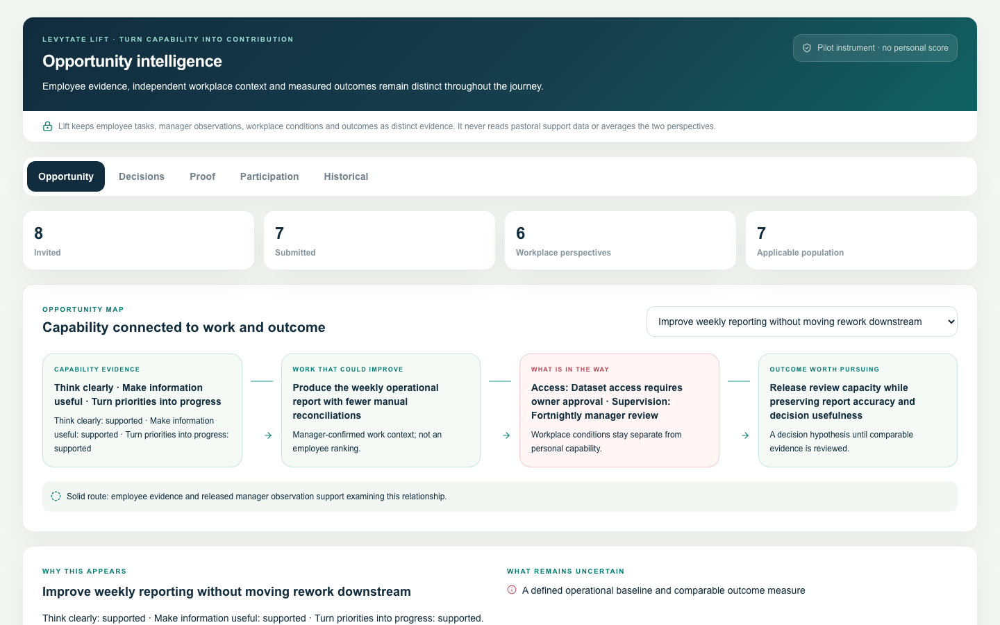
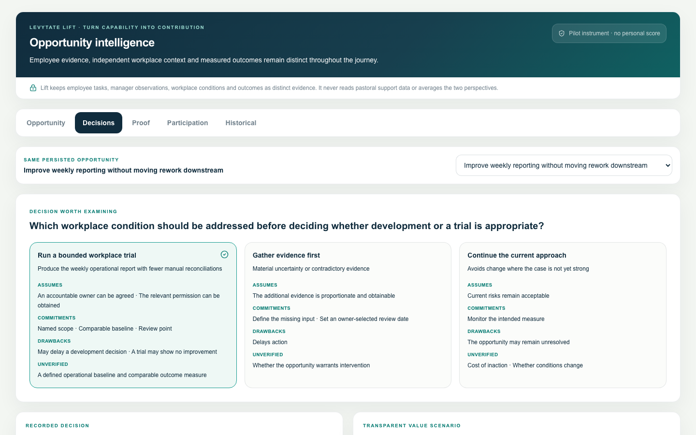
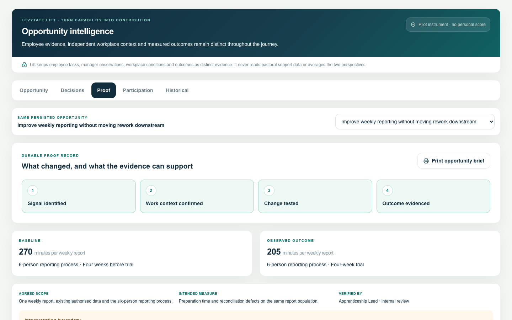
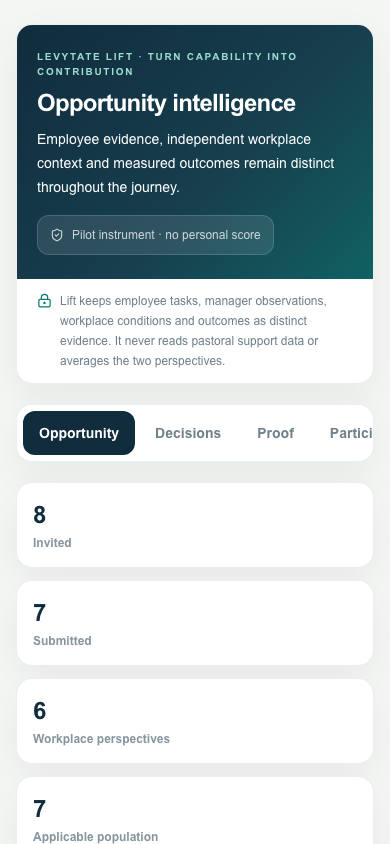

# LevyTate Lift — first working release

## Product boundary

Lift connects a controlled workforce-capability assessment to independent workplace observation, evidence-backed opportunities, explicit employer decisions and subsequent proof. It is not a score dashboard, psychometric claim, automated employment decision, questionnaire builder or generic planning tool.

The corrected pilot is version-pinned to `lift-workforce-v1`, `lift-workforce-questionnaire-v1.1`, `lift-workforce-rules-v1.1` and `lift-opportunity-grouping-v1`. Historical V1–V3 assessments and earlier Lift evidence retain their original versions and interpretation. No historical result is silently mapped or rewritten.

## End-to-end journey

1. An Apprenticeship Lead invites active employees in their own organisation to the single published instrument.
2. Employees complete three unscored context questions and 30 scenario/work-sample items with saved progress and explicit submission.
3. A current Line Manager records team context once, then submits an independent Workplace Perspective for current direct reports only.
4. Employee findings stay unavailable to the manager until both initial submissions exist. The two sources then appear side by side and are never averaged.
5. One replay-safe reconciliation path runs after either submission. A failed response can be retried without duplicating evidence or candidates, and the initial manager revision is immutable after submission.
6. Individual opportunity candidates retain authorised evidence privately. Employer routes group candidates only within the same campaign, framework, questionnaire, interpretation version and controlled workflow group. Free-text wording is never the grouping key or employer narrative.
7. The Opportunity Map is created only after minimum-five and complementary-suppression checks cover the route's existence, label, detail and counts. A mobile ordered story is equivalent to the desktop canvas.
8. Decisions preserve options, assumptions, costs, drawbacks, rationale, owner, intended measure and overlapping-benefit identifiers.
9. Proof preserves comparable baseline and outcome evidence, verification, other relevant changes and limitations. A click alone cannot advance evidence state.

## Roles and privacy

- **Employee:** own invited assessment, own submitted findings and released manager context only.
- **Line Manager:** current direct reports only; no employee findings before independent initial submission.
- **Apprenticeship Lead / Employer Admin:** invitation and privacy-safe organisation views; aggregates require five distinct contributors and complementary suppression.
- **Platform Admin and provider:** no employer Lift assessment access.

Lift does not query pastoral tables or send pastoral content to an interpretation path. Draft answers do not enter employer analytics. Service-role database access is additionally constrained by application-level session, role, organisation, employee and reporting-relationship checks. Browser roles have no direct table privileges.

## Feature gate

Lift fails closed unless every condition is true:

- `LEVYTATE_LIFT_ENABLED=true`;
- `LEVYTATE_LIFT_RUNTIME_SCOPE=local` in local development with no Vercel runtime, or `preview` on Vercel Preview;
- for Preview, `LEVYTATE_LIFT_ALLOWED_BRANCH=feature/operational-rbac` and `VERCEL_GIT_COMMIT_REF=feature/operational-rbac`;
- `LEVYTATE_LIFT_ALLOWED_ORGANISATION_ID` exactly matches the one separately authorised fictional organisation; and
- the organisation has `lift_enabled=true` in the schema introduced by migration 039.

Production and unrecognised runtimes always return disabled. The local fixture preview additionally requires development mode and `LEVYTATE_LIFT_FIXTURE_PREVIEW=true`; it is a 404 in deployed builds.

## Honest release status

The implementation and migration can be validated in isolation. Shared end-to-end persistence remains unavailable until migration 039 and one fictional Preview workspace capability are separately authorised. The pilot instrument still requires subject-matter, accessibility, privacy and measurement review before live employee use.

## Isolated fixture screenshots

These screenshots use fictional, deterministic local fixtures. The route that renders them returns 404 in deployed environments.

